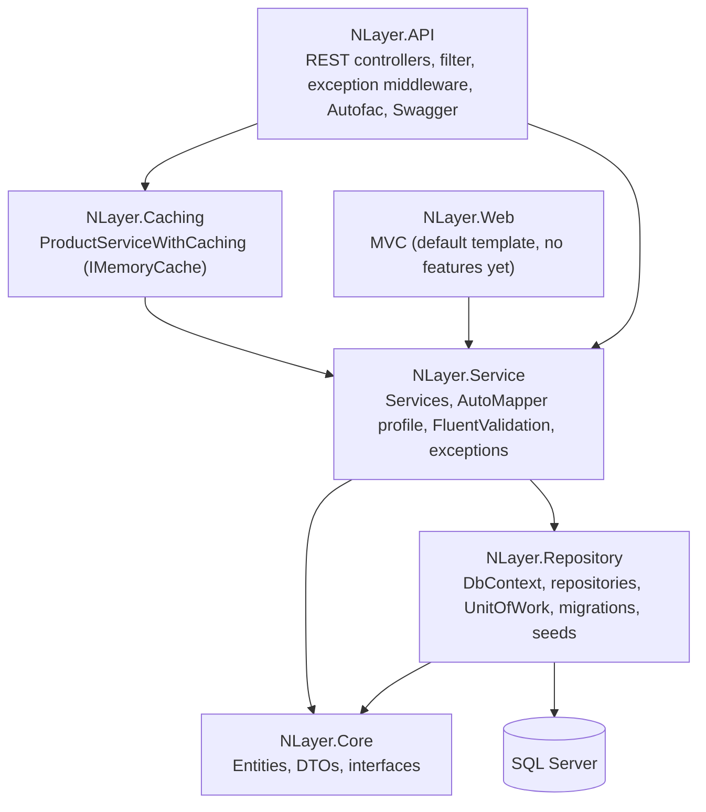

# NlayerApp

[Türkçe](README.tr.md)

An N-layer architecture example / learning project (2024) built with ASP.NET Core (.NET 8) and Entity Framework Core. It exposes a small product/category REST API and contains a separate, mostly empty MVC web project. This repository contains the web application only; other components of the original project are not included.

**Status:** unfinished learning/example project. Last commit April 2024. Not production-ready (see [Known limitations](#known-limitations)).

## Architecture



(Project references follow the `.csproj` files; `NLayer.API` reaches Service/Repository/Core transitively.)

## Layers

| Project | Contents |
|---|---|
| `NLayer.Core` | Entities (`BaseEntity`, `Product`, `Category`, `ProductFeature`), DTOs (`CustomResponseDto<T>` wrapper, product/category DTOs), and the interfaces for repositories, services and `IUnitOfWork`. |
| `NLayer.Repository` | `AppDbContext` (EF Core, SQL Server), `GenericRepository<T>`, `ProductRepository`, `CategoryRepository`, `UnitOfWork` (wraps `SaveChanges`), entity configurations, seed data (3 categories, 5 products, 2 product features), and the `initial` migration. |
| `NLayer.Service` | Generic `Service<T>` plus `ProductService` and `CategoryService`, AutoMapper `MapProfile`, FluentValidation `ProductDtoValidator`, `NotFoundException` and `ClientSideException`. |
| `NLayer.Caching` | `ProductServiceWithCaching`: an `IProductService` implementation that keeps the product list in `IMemoryCache` (in-process; no Redis) and refreshes it after writes. See limitations: it is not registered in DI. |
| `NLayer.API` | Controllers (`Products`, `Categories`), `ValidateFilterAttribute` (returns 400 with validation messages), custom global exception middleware (maps exceptions to 400/404/500 JSON), Autofac module for registrations, CORS policy, Swagger (Development only). |
| `NLayer.Web` | ASP.NET Core MVC project from the default template. It references the Service layer, but has no product views or actions. |

Patterns used: generic repository, Unit of Work, service layer, DTOs with AutoMapper, FluentValidation, action filter, exception-handling middleware, Autofac dependency injection.

## Project structure

```
NlayerApp.sln
NLayer.API/          controllers, filters, middlewares, Autofac module, Program.cs
NLayer.Caching/      ProductServiceWithCaching.cs
NLayer.Core/         Models, DTOs, Repositories, Services, UnitOfWorks (interfaces)
NLayer.Repository/   AppDbContext, Configurations, Migrations, Repositories, Seeds, UnitOfWorks
NLayer.Service/      Services, Mapping, Validations, Exceptions
NLayer.Web/          MVC app (Views, wwwroot)
```

## Getting started

Requirements: .NET 8 SDK, SQL Server (or LocalDB), and the `dotnet-ef` tool (`dotnet tool install --global dotnet-ef`).

1. Provide a connection string. `NLayer.API/appsettings.json` ships with an empty `ConnectionStrings:SqlConnection`. Set it without committing it, for example via an environment variable:

   ```bash
   # bash
   export ConnectionStrings__SqlConnection="<your SQL Server connection string>"
   ```
   ```powershell
   # PowerShell
   $env:ConnectionStrings__SqlConnection = "<your SQL Server connection string>"
   ```

2. Create the database from the included migration:

   ```bash
   dotnet ef database update --project NLayer.Repository --startup-project NLayer.API
   ```

3. Run the API (Swagger opens at `/swagger` in Development):

   ```bash
   dotnet run --project NLayer.API --launch-profile https
   ```
   Default URLs: `https://localhost:7269`, `http://localhost:5002`.

4. Optional: `dotnet run --project NLayer.Web` starts the MVC site (default template page only).

## API endpoints

Base path `api/[controller]`. Responses are wrapped in `CustomResponseDto<T>` (status code, data, errors).

| Method | Route | Description |
|---|---|---|
| GET | `/api/Products` | List all products |
| GET | `/api/Products/{id}` | Get a product by id |
| GET | `/api/Products/GetProductsWithCategory` | List products including their category |
| POST | `/api/Products` | Create a product (`ProductDto`, validated) |
| PUT | `/api/Products` | Update a product (`ProductUpdateDto`) |
| DELETE | `/api/Products/{id}` | Delete a product |
| GET | `/api/Categories` | List all categories |
| GET | `/api/Categories/GetSingleCategoryByIdWithProdutcsAsync/{categoryId}` | Get a category with its products |

## Known limitations

- No automated tests.
- Build verified: `dotnet build` on a copy succeeds with 0 errors and 29 warnings (nullable references, deprecated FluentValidation registration calls). The application was not run and the database was not accessed, so runtime behavior is unverified.
- `ProductServiceWithCaching` is not wired in: the Autofac module only scans the API, Repository and Service assemblies, so `ProductService` (no caching) serves requests. `AddMemoryCache()` is registered but unused. Parts of the caching class are incomplete (`AnyAsync` throws `NotImplementedException`).
- `ProductDtoValidator` requires `Id >= 1`, so creating a product through `POST` must send a non-zero `Id`, which does not fit auto-generated keys. `ProductUpdateDto` has no validator.
- `NLayer.Web` has no product pages; its `ProductsController` is empty and `IProductService` is not registered in that project.
- CORS allows any origin/header/method; there is no authentication or authorization.
- Seed data uses `DateTime.Now`, which makes migrations non-deterministic if regenerated.
- Error messages and seed data are partly in Turkish; there are naming typos (`...WithProdutcsAsync`).

## License

No license file is included.
