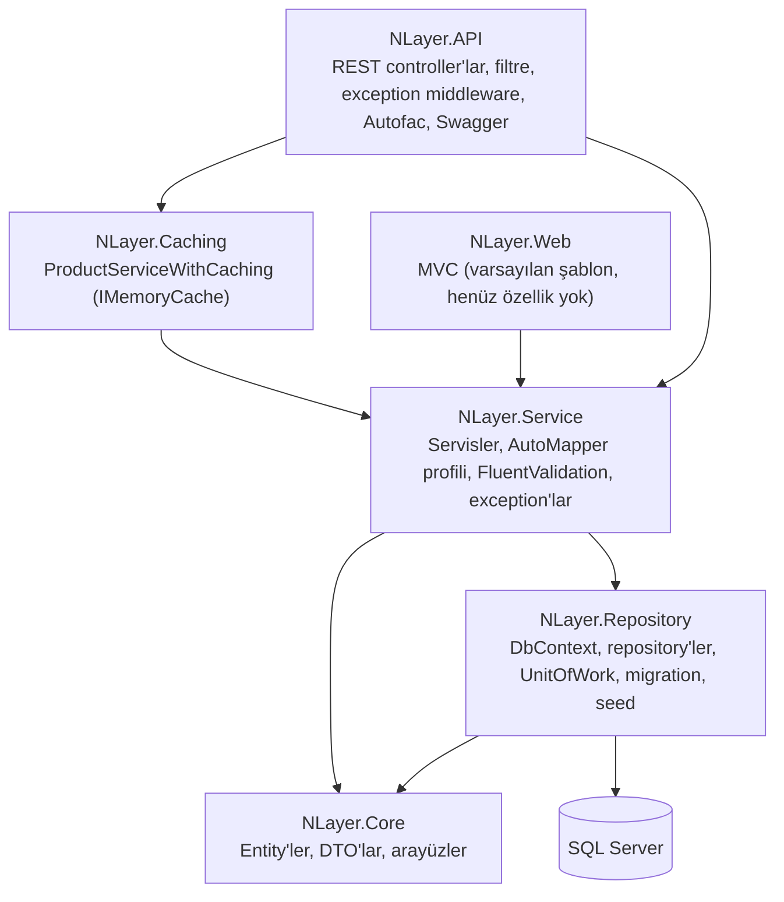

# NlayerApp

[English](README.md)

ASP.NET Core (.NET 8) ve Entity Framework Core ile yazılmış bir N-katmanlı mimari örneği / öğrenme projesi (2024). Küçük bir ürün/kategori REST API'si ve ayrı, büyük ölçüde boş bir MVC web projesi içerir. Bu depo web uygulamasını içerir; orijinal projenin diğer bileşenleri bu depoya dahil değildir.

**Durum:** tamamlanmamış öğrenme/örnek projesi. Son commit Nisan 2024. Üretime hazır değildir ([Bilinen sınırlar](#bilinen-sınırlar)).

## Mimari



(Proje referansları `.csproj` dosyalarına göredir; `NLayer.API`, Service/Repository/Core'a dolaylı olarak ulaşır.)

## Katmanlar

| Proje | İçerik |
|---|---|
| `NLayer.Core` | Entity'ler (`BaseEntity`, `Product`, `Category`, `ProductFeature`), DTO'lar (`CustomResponseDto<T>` sarmalayıcısı, ürün/kategori DTO'ları), repository, servis ve `IUnitOfWork` arayüzleri. |
| `NLayer.Repository` | `AppDbContext` (EF Core, SQL Server), `GenericRepository<T>`, `ProductRepository`, `CategoryRepository`, `UnitOfWork` (`SaveChanges` sarmalayıcısı), entity konfigürasyonları, seed verisi (3 kategori, 5 ürün, 2 ürün özelliği) ve `initial` migration. |
| `NLayer.Service` | Generic `Service<T>`, `ProductService` ve `CategoryService`, AutoMapper `MapProfile`, FluentValidation `ProductDtoValidator`, `NotFoundException` ve `ClientSideException`. |
| `NLayer.Caching` | `ProductServiceWithCaching`: ürün listesini `IMemoryCache` içinde (süreç içi; Redis yok) tutan ve yazma işlemlerinden sonra yenileyen `IProductService` gerçeklemesi. Sınırlara bakın: DI'a kayıtlı değildir. |
| `NLayer.API` | Controller'lar (`Products`, `Categories`), `ValidateFilterAttribute` (doğrulama mesajlarıyla 400 döner), global exception middleware (exception'ları 400/404/500 JSON'a çevirir), kayıtlar için Autofac modülü, CORS politikası, Swagger (yalnızca Development). |
| `NLayer.Web` | Varsayılan şablondan ASP.NET Core MVC projesi. Service katmanına referans verir ama ürün görünümü/aksiyonu yoktur. |

Kullanılan desenler: generic repository, Unit of Work, servis katmanı, AutoMapper ile DTO, FluentValidation, action filter, exception-handling middleware, Autofac ile bağımlılık enjeksiyonu.

## Proje yapısı

```
NlayerApp.sln
NLayer.API/          controller'lar, filtreler, middleware'ler, Autofac modülü, Program.cs
NLayer.Caching/      ProductServiceWithCaching.cs
NLayer.Core/         Models, DTOs, Repositories, Services, UnitOfWorks (arayüzler)
NLayer.Repository/   AppDbContext, Configurations, Migrations, Repositories, Seeds, UnitOfWorks
NLayer.Service/      Services, Mapping, Validations, Exceptions
NLayer.Web/          MVC uygulaması (Views, wwwroot)
```

## Çalıştırma

Gereksinimler: .NET 8 SDK, SQL Server (veya LocalDB) ve `dotnet-ef` aracı (`dotnet tool install --global dotnet-ef`).

1. Bağlantı dizesini verin. `NLayer.API/appsettings.json` içinde `ConnectionStrings:SqlConnection` boştur. Depoya yazmadan, örneğin ortam değişkeniyle ayarlayın:

   ```bash
   # bash
   export ConnectionStrings__SqlConnection="<SQL Server bağlantı dizeniz>"
   ```
   ```powershell
   # PowerShell
   $env:ConnectionStrings__SqlConnection = "<SQL Server bağlantı dizeniz>"
   ```

2. Dahil edilen migration ile veritabanını oluşturun:

   ```bash
   dotnet ef database update --project NLayer.Repository --startup-project NLayer.API
   ```

3. API'yi çalıştırın (Development'ta Swagger `/swagger` adresinde açılır):

   ```bash
   dotnet run --project NLayer.API --launch-profile https
   ```
   Varsayılan adresler: `https://localhost:7269`, `http://localhost:5002`.

4. İsteğe bağlı: `dotnet run --project NLayer.Web` MVC sitesini başlatır (yalnızca varsayılan şablon sayfası).

## API uç noktaları

Temel yol `api/[controller]`. Yanıtlar `CustomResponseDto<T>` (durum kodu, veri, hatalar) ile sarılır.

| Metot | Rota | Açıklama |
|---|---|---|
| GET | `/api/Products` | Tüm ürünleri listeler |
| GET | `/api/Products/{id}` | Id ile ürün getirir |
| GET | `/api/Products/GetProductsWithCategory` | Ürünleri kategorileriyle listeler |
| POST | `/api/Products` | Ürün oluşturur (`ProductDto`, doğrulanır) |
| PUT | `/api/Products` | Ürün günceller (`ProductUpdateDto`) |
| DELETE | `/api/Products/{id}` | Ürün siler |
| GET | `/api/Categories` | Tüm kategorileri listeler |
| GET | `/api/Categories/GetSingleCategoryByIdWithProdutcsAsync/{categoryId}` | Kategoriyi ürünleriyle getirir |

## Bilinen sınırlar

- Otomatik test yok.
- Derleme doğrulandı: kopya üzerinde `dotnet build` 0 hata, 29 uyarıyla (nullable referanslar, kullanımdan kalkmış FluentValidation kayıt çağrıları) başarılı. Uygulama çalıştırılmadı ve veritabanına bağlanılmadı; çalışma zamanı davranışı doğrulanmadı.
- `ProductServiceWithCaching` bağlı değil: Autofac modülü yalnızca API, Repository ve Service assembly'lerini taradığı için istekleri (cache'siz) `ProductService` karşılar. `AddMemoryCache()` kayıtlı ama kullanılmıyor. Cache sınıfının bazı kısımları eksik (`AnyAsync` `NotImplementedException` fırlatır).
- `ProductDtoValidator` `Id >= 1` şartı koşar; bu yüzden `POST` ile ürün oluştururken sıfırdan farklı bir `Id` göndermek gerekir, bu otomatik üretilen anahtarlarla uyumlu değildir. `ProductUpdateDto` için validator yok.
- `NLayer.Web` içinde ürün sayfası yok; `ProductsController` boş ve `IProductService` bu projede kayıtlı değil.
- CORS her origin/header/metoda açık; kimlik doğrulama veya yetkilendirme yok.
- Seed verisi `DateTime.Now` kullanır; migration yeniden üretilirse deterministik olmaz.
- Hata mesajları ve seed verisi kısmen Türkçe; adlandırma yazım hataları var (`...WithProdutcsAsync`).

## Lisans

Lisans dosyası eklenmemiştir.
